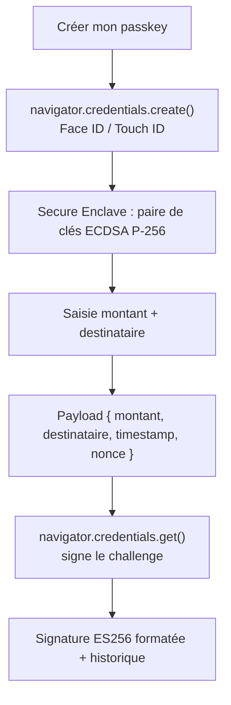

# Signex

**A browser demo of DSP2/SCA-style transaction signing using WebAuthn passkeys — Face ID / Touch ID instead of OTP.**

[](#limites-de-la-démo)
[](https://www.w3.org/TR/webauthn-2/)
[](#choix-techniques)
[](#stack-technique)

Signex illustre le mécanisme de **dynamic linking** exigé par la DSP2 pour l'authentification forte des paiements
(SCA) : chaque transaction génère une signature ES256 unique, ancrée dans le biométrique de l'utilisateur. Le
payload signé embarque le montant, le destinataire, un timestamp et un nonce — la signature est donc liée à
*cette* transaction précise et non-rejouable par construction.

Side project pédagogique, pas un produit : pas de backend, la vérification de signature est simulée côté client.


## Lancer le projet

```bash
git clone https://github.com/jxgedouard/signex.git
cd signex
python -m http.server 8000
```

Ouvre `http://localhost:8000` dans Chrome ou Safari. WebAuthn fonctionne sur `localhost` sans HTTPS ; pour
tester Face ID sur mobile, utilise la démo en ligne.

**Demo** : [jxgedouard.github.io/signex](https://jxgedouard.github.io/signex)

## Comment ça marche



| Fichier | Rôle |
|---|---|
| `js/webauthn.js` | Enregistrement et assertion WebAuthn (`navigator.credentials`) |
| `js/crypto.js` | Construction du payload, encodage base64url, formatage de la signature |
| `js/ui.js` | Navigation, historique, démonstration de non-rejouabilité |

## Choix techniques

**WebAuthn plutôt qu'OTP/HMAC.** Un OTP ou un HMAC repose sur un secret partagé — si le serveur est compromis,
tout est compromis. WebAuthn est asymétrique : la clé privée ne quitte jamais le secure enclave de l'appareil,
le serveur ne connaît que la clé publique.

**ES256 (ECDSA P-256).** Algorithme recommandé par le NIST, standard de facto des passkeys sur iOS, macOS,
Android et Windows Hello — signatures courtes, rapides à vérifier.

**Vanilla JS, zéro dépendance.** Pour une démo de sécurité, importer des centaines de packages npm serait
contradictoire. Toute la cryptographie est déléguée au navigateur et au secure enclave — aucune implémentation
maison d'algorithme ("never roll your own crypto").

**Lien avec la DSP2.** La SCA exige deux facteurs parmi connaissance/possession/inhérence : WebAuthn couvre
possession (l'appareil) et inhérence (le biométrique). Le dynamic linking est assuré par le payload
`{ montant, destinataire, timestamp, nonce }` encodé dans le challenge WebAuthn.

## Limites de la démo

| Point | Dans Signex | En production |
|---|---|---|
| Vérification de signature | Simulée côté client | Côté serveur, via `fido2-lib` / `py_webauthn` |
| Stockage clé publique / historique | Mémoire de session | Base de données |
| Multi-appareils, révocation | Non implémentés | Plusieurs credentials, endpoint de révocation |

## License

Side project personnel, sans licence explicite — demande avant réutilisation.
